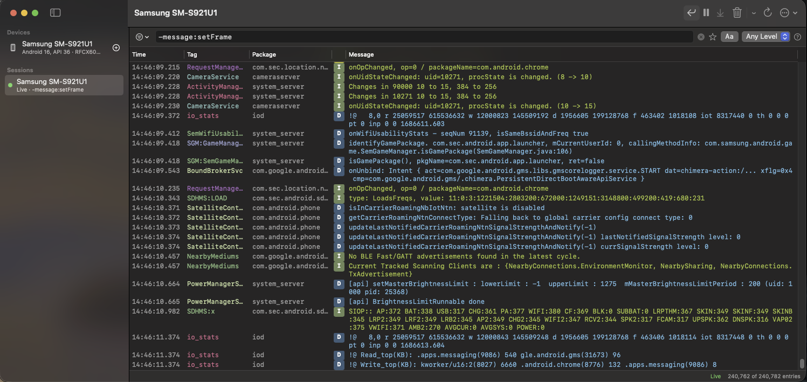

# Logcatnip

A native macOS app for reading Android logcat. It follows every connected device, keeps a separate session
per device (or several per device, each with its own filter), and filters with the same query language as
Android Studio's Logcat window.



## Features

- **Devices and sessions.** Devices appear in the sidebar as adb reports them. Open one or more logcat
  sessions per device; each has its own filter, pause state and buffer. When a device disconnects, its
  sessions keep their logs and resume where they left off when it comes back.
- **Android Studio filter syntax.** `tag:`, `package:`, `process:`, `message:`, `line:`, `level:`, `age:`,
  `is:crash`, `is:stacktrace`, `is:firebase`, `is:<level>`, `name:`, plus `pid:` and `tid:`. Every text key
  supports contains (`key:`), exact (`key=:`), regex (`key~:`) and negation (`-key:`). Combine terms with
  `&`, `|` and parentheses. Spaces have the lowest precedence, and same-key terms are ORed, as in Android
  Studio.
- **package:mine.** List your app's packages in Settings.
- **Fast table.** Hundreds of thousands of entries, level colors, stable per-tag colors, multi-line stack
  traces, column hiding (right-click the header), and follow mode that stops when you scroll up. Long
  lines scroll horizontally, or turn on Wrap Lines in the toolbar to wrap them to the window width.
- **Filter from a line.** Right-click a line to show only or hide its tag, package, PID or TID, or set the
  minimum level.
- **Favorites and recents** for filter queries, a match-case toggle, and a minimum-level picker.
- **Import and export.** Export in `logcat -v long` format. Open long or threadtime (`adb logcat` default,
  bug report) files, or drop them on the window.
- Pause, clear the view, clear the device buffer (`logcat -c`), and restart logcat.

## Requirements

- macOS 14 or later
- Xcode 16 / Swift 6 toolchain to build
- `adb` from the Android SDK platform-tools. Logcatnip looks in `$ANDROID_HOME`, `$ANDROID_SDK_ROOT`,
  `~/Library/Android/sdk`, Homebrew and `PATH`, or you can set the path in Settings.

## Build and run

```sh
swift run Logcatnip              # run from the terminal
scripts/build-app.sh             # build build/Logcatnip.app (ad-hoc signed)
open build/Logcatnip.app
```

You can also open `Package.swift` in Xcode and run the `Logcatnip` scheme.

## Tests

```sh
swift test                                   # parser, filter and screenshot tests
LOGCATNIP_DEVICE_TESTS=1 swift test          # also run against an attached device
LOGCATNIP_RECORD_SNAPSHOTS=1 swift test      # rewrite the screenshot references
```

Screenshot tests render the session view offscreen and compare it with PNGs in
`Tests/LogcatnipTests/__Snapshots__/macOS-<major>/`. Text renders differently between macOS releases, so
each major version has its own references. A missing reference is recorded and the test fails until you
check the image and run again; on CI (`CI` set) it is only recorded. A mismatch writes the actual image
and a diff to `.build/snapshot-failures/`.

`LOGCATNIP_DEBUG=1 swift run Logcatnip` prints device and session state to stderr every few seconds.
`LOGCATNIP_FILTER='level:WARN'` sets the filter of new sessions.

## Filter reference

| Query | Matches |
| --- | --- |
| `tag:foo` / `tag=:foo` / `tag~:fo+` | tag contains / equals / matches regex |
| `-tag:foo` | negation; works with every key and with free text |
| `package:com.example` | package (process name before `:`) |
| `process:com.example:remote` | full process name |
| `message:timeout` | message text |
| `line:foo`, `foo`, `"foo bar"` | anywhere in the line |
| `package:mine` | packages listed in Settings |
| `level:WARN` | WARN and above (`V D I W E A` work too) |
| `age:30s`, `age:5m`, `age:2h`, `age:1d` | recent entries only |
| `is:crash`, `is:stacktrace` | crashes and ANRs; entries containing stack frames |
| `is:error` (any level name) | exactly that level (`level:` is that level and above) |
| `is:firebase` | Firebase SDK tags (`FA`, `FirebaseMessaging`, …) |
| `pid:1234`, `tid:5678` | process or thread id |
| `name:"My filter"` | names the filter |
| `(tag:a \| tag:b) & level:E` | explicit operators; `&` binds tighter than `\|` |

Unquoted values end at whitespace, `&` or `|` (regex values only at whitespace). Quote values that contain
them.

### Precedence

Spaces separate terms with the lowest precedence, as in Android Studio, so `foo bar tag:a | tag:b` means
`"foo bar" & (tag:a | tag:b)`. Among the space-separated terms, non-negated terms with the same key are
ORed and the rest are ANDed: `tag:a tag:b level:W` means `(tag:a | tag:b) & level:W`, and negated terms
are always ANDed. `package:mine` is never ORed, so `package:mine package:foo` needs both. Parentheses may
hold a whole sequence, and `()` matches everything.

Before 0.2, spaces bound tighter than `&` and `|`. Saved favorites and recent filters whose meaning changed
are marked ⚠︎ in the filter menu once, until you remove them or choose Dismiss ⚠︎ Warnings.

## Layout

- `Sources/LogcatKit`: parsing (`logcat -v long`, threadtime), the filter language, and adb
  (device tracking, logcat streaming, process names). No UI dependencies.
- `Sources/Logcatnip`: the SwiftUI + AppKit app.
- `Tests/LogcatKitTests`: unit tests, plus opt-in device tests.
- `Tests/LogcatnipTests`: screenshot tests of the app's views.

Long-running adb commands run under a small `sh` watchdog that stops them when the app exits, even if it
crashes.
