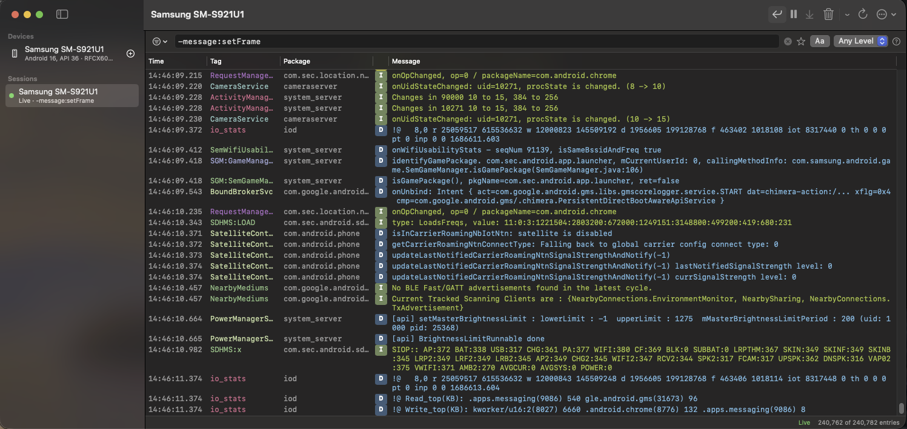

# Logcatnip

A native macOS app for reading Android logcat. It follows every connected device, keeps a separate session
per device (or several per device, each with its own filter), and filters with the same query language as
Android Studio's Logcat window.



## Features

- **Devices and sessions.** Each physical device gets one sidebar row, with icons for how it is connected
  (USB, Wi-Fi, emulator). Open one or more logcat sessions per device; each has its own filter, pause state
  and buffer. Sessions follow the device rather than the adb serial: when it disconnects they keep their
  logs and resume where they left off when it comes back, even on a new Wi-Fi port, as an emulator on
  another port, or over Wi-Fi after you unplug USB. When both USB and Wi-Fi are connected, logs stream over
  USB.
- **Wireless debugging.** Devices › + › Connect over Wi-Fi… (⇧⌘N) pairs an Android 11 or later device with a
  QR code or a pairing code, or connects to `host:port` (recent hosts are remembered). Devices that
  advertise wireless debugging but aren't connected appear under Discovered with a Connect button. Devices
  connected by address can be disconnected from their context menu; adb can't disconnect devices it
  connected over mDNS, so turn off Wireless debugging on the device for those. If `adb server-status` shows
  `mdns_enabled: false`, the window explains how to turn mDNS on.
- **Android Studio filter syntax.** `tag:`, `package:`, `process:`, `message:`, `line:`, `level:`, `age:`,
  `is:crash`, `is:stacktrace`, `is:firebase`, `is:<level>`, `name:`, plus `pid:` and `tid:`. Every text key
  supports contains (`key:`), exact (`key=:`), regex (`key~:`) and negation (`-key:`). Combine terms with
  `&`, `|` and parentheses. Spaces have the lowest precedence, and same-key terms are ORed, as in Android
  Studio. Logcatnip adds `is:anr`, `is:leak` and `is:jank` for ANRs, leaks and skipped frames.
- **package:mine.** List your app's packages in Settings.
- **Fast table.** Hundreds of thousands of entries, level colors, stable per-tag colors, multi-line stack
  traces, column hiding (right-click the header), and follow mode that stops when you scroll up. Long
  lines scroll horizontally, or turn on Wrap Lines in the toolbar to wrap them to the window width.
- **Find in results.** ⌘F opens a find bar that searches the tag and message of the rows shown (after the
  filter), with match case, regex and whole word options. Every match is highlighted, the current one in
  orange, with an "N of M" counter and tick marks on the scroller. Return or ⌘G goes to the next match,
  ⇧Return or ⇧⌘G to the previous (both wrap), ⌘E searches for the selected text or line, and Esc closes the
  bar. ⌘L focuses the filter.
- **Crash navigator.** Crashes, native crashes, ANRs, leaks, out-of-memory kills and skipped frames are
  detected as they stream in. The status bar counts them ("2 crashes · 1 ANR · 3 warnings"); click it for
  the list, grouped by signature with a count, where clicking an occurrence selects it in the log. The
  scroller marks crashes and ANRs in red, warnings in orange and every error line faintly, and crash rows are
  tinted. ⌘' and ⇧⌘' go to the next and previous crash or ANR, ⌘] and ⌘[ to the next and previous error.
  None of these change the filter; occurrences it hides are greyed out in the list.
- **Copy Crash Report** (⌥⌘C, or right-click a crash line or a list entry) copies Markdown for an issue: the
  app's installed version, the device and build, and the crashing process's preceding lines (50 by default,
  set in Settings) with the full stack trace or tombstone in a code block. Leaks, out of memory and jank have
  the same report as **Copy Report** in their right-click menus.
- **Open in editor.** Right-click a stack frame line to open its file at that line in Android Studio or
  another editor, or use Open Top Frame on a crash in the list. See [Open in editor](#open-in-editor).
- **Filter from a line.** Right-click a line to show only or hide its tag, package, PID or TID, or to show its
  level and above. The new term applies to the whole query: Show Only replaces the query's top-level terms
  for that key instead of ORing with them, and a query with a top-level `|` is wrapped in parentheses first.
- **Favorites and recents** for filter queries, a match-case toggle, and a minimum-level picker that edits
  the top-level `level:` term and shows Mixed when the level comes from `is:<level>` or from inside a group.
- **Import and export.** Export in `logcat -v long` format. Open long or threadtime (`adb logcat` default,
  bug report) files, or drop them on the window.
- Pause, clear the view, clear the device buffer (`logcat -c`), and restart logcat.
- Android 6.0 and older: their logcat has no `-v epoch` or `-v uid`, so Logcatnip reads device-local times
  (in the Mac's time zone) and shows no uid. It switches automatically when getprop or logcat reports an old
  release.
- If logcat rejects an option, for example an unknown buffer in Settings › Logcat › Buffers, the status bar
  shows logcat's message. Fix the setting and choose Restart Logcat.
- **iOS simulators.** Booted simulators (iOS, watchOS, tvOS, visionOS) appear in the sidebar next to Android
  devices. A simulator session streams its unified log with `simctl spawn <udid> log stream`, and uses the
  same table, filters and export. See [iOS simulator logs](#ios-simulator-logs).

## Install and update

Download `Logcatnip-X.Y.Z.dmg` from the [releases page](https://github.com/GreenmistStudios/logcatnip/releases),
open it and drag Logcatnip onto Applications. Releases are signed with a Developer ID and notarized by Apple, so
macOS opens them without a warning. (Releases before Developer ID signing were ad-hoc signed; if macOS blocks one
of those, run `xattr -dr com.apple.quarantine /Applications/Logcatnip.app`.)

Or install from Terminal:

```sh
curl -fsSL https://raw.githubusercontent.com/GreenmistStudios/logcatnip/main/scripts/install.sh | bash
```

It downloads the latest release, checks it against the release's SHA-256 and the app's code signature, installs
it to `/Applications` (or `~/Applications` when that isn't writable) and opens it. Run it again to update.
`LOGCATNIP_VERSION=X.Y.Z` installs a specific release, `LOGCATNIP_INSTALL_DIR` picks another folder and
`LOGCATNIP_NO_OPEN=1` skips opening the app. curl doesn't quarantine what it downloads, so this also installs the
older ad-hoc signed releases without a warning.

Logcatnip checks GitHub Releases once a day (Settings › Updates; Logcatnip › Check for Updates… at any time).
When there is a newer release it shows the release notes and offers to download it. The download is checked
against the release's SHA-256, the bundle identifier, the version and the code signature before Install and
Relaunch swaps it in. A Developer ID build only installs updates signed by the same team. Updating in place
needs the app in a folder you can write to; when it isn't, the window links to the release page instead.

## Requirements

- macOS 14 or later
- Xcode 16 / Swift 6 toolchain to build
- `adb` from the Android SDK platform-tools. Logcatnip looks in `$ANDROID_HOME`, `$ANDROID_SDK_ROOT`,
  `~/Library/Android/sdk`, Homebrew and `PATH`, or you can set the path in Settings.
- Wireless pairing needs recent platform-tools with mDNS (`adb mdns check`) and the Mac and device on the
  same network.
- Xcode, only for iOS simulator logs. Logcatnip uses `simctl` from the developer directory that
  `xcode-select -p` reports (or `$DEVELOPER_DIR`). Without Xcode, simulators are hidden and Settings says why.

## Build and run

```sh
swift run Logcatnip              # run from the terminal
scripts/build-app.sh             # build build/Logcatnip.app (ad-hoc signed)
open build/Logcatnip.app
```

You can also open `Package.swift` in Xcode and run the `Logcatnip` scheme.

## Tests

```sh
swift test                                   # parser, filter and screenshot tests
LOGCATNIP_DEVICE_TESTS=1 swift test          # also run against an attached device
LOGCATNIP_SIMULATOR_TESTS=1 swift test       # also stream from a booted simulator
LOGCATNIP_RECORD_SNAPSHOTS=1 swift test      # rewrite the screenshot references
```

Screenshot tests render the session view offscreen and compare it with PNGs in
`Tests/LogcatnipTests/__Snapshots__/macOS-<major>/`. Text renders differently between macOS releases, so
each major version has its own references. A missing reference is recorded and the test fails until you
check the image and run again; on CI (`CI` set) it is only recorded. A mismatch writes the actual image
and a diff to `.build/snapshot-failures/`.

`LOGCATNIP_DEBUG=1 swift run Logcatnip` prints device and session state to stderr every few seconds.
`LOGCATNIP_FILTER='level:WARN'` sets the filter of new sessions, `LOGCATNIP_FIND='text'` opens the find bar
with that query, and `LOGCATNIP_OPEN=/path/a.txt:/path/b.txt` opens log files at launch. With
`LOGCATNIP_DEBUG=1` the find bar's state is printed too, including a recount from scratch (`check=ok`).
`LOGCATNIP_PERF_TESTS=1 swift test --filter FindPerformance` times find on 500,000 rows.
`LOGCATNIP_WIFI_SHEET=qr|code|ip` opens the Connect over Wi-Fi sheet, `LOGCATNIP_WIFI_CONNECT=host:port|discovered`
connects, and `LOGCATNIP_WIFI_PAIR="host:port|discovered CODE"` pairs, without clicking.

`LOGCATNIP_UPDATE_CHECK=1` runs Check for Updates… at launch, and `LOGCATNIP_UPDATE_INSTALL=1` with it downloads and
installs what it finds without clicking. `LOGCATNIP_UPDATE_FEED=/path/release.json` (or a URL) reads releases from
a copy of the GitHub API response instead, and `LOGCATNIP_UPDATE_VERSION=0.1.0` pretends to be that version. With
`LOGCATNIP_DEBUG=1` each update step is logged as `update:`.

## Releases

Every merge to `main` runs `.github/workflows/release.yml`. `scripts/next-version.sh` reads the conventional
commits since the last `vX.Y.Z` tag and picks the bump:

| Commits since the last tag | Bump |
| --- | --- |
| `type!:` subject or a `BREAKING CHANGE:` footer | major (minor while the version is 0.x) |
| `feat:` | minor |
| `fix:`, `perf:`, `refactor:`, `revert:` | patch |
| only `docs:`, `chore:`, `ci:`, `test:`, `style:`, `build:` | no release |

The workflow then runs the tests, builds the app with that version, signs it with the Developer ID, notarizes
it, and publishes a GitHub release tagged `vX.Y.Z` with `Logcatnip-X.Y.Z.dmg` (the installer),
`Logcatnip-X.Y.Z.zip` (what the updater downloads), a `.sha256` for each and notes generated from the merged
pull requests. The tag is the only record of the version: nothing is committed back. To force a release, or to
cut 1.0, run the Release workflow by hand and choose the bump. Local builds take the newest tag as their version
(`0.0.0` before the first release); set `VERSION=` to override it.

### Signing releases

The release workflow needs five repository secrets (Settings › Secrets and variables › Actions). It fails
rather than publish an unsigned release, because signed copies refuse updates from another team.

| Secret | Value |
| --- | --- |
| `DEVELOPER_ID_P12` | The Developer ID Application certificate and its private key: in Keychain Access, select the certificate, File › Export Items… as `.p12`, then `base64 -i cert.p12 \| pbcopy` |
| `DEVELOPER_ID_P12_PASSWORD` | The password you gave the `.p12` |
| `NOTARY_KEY_P8` | An App Store Connect API key (Users and Access › Integrations › Team Keys, Developer access): `base64 -i AuthKey_XXXX.p8 \| pbcopy` |
| `NOTARY_KEY_ID` | That key's ID |
| `NOTARY_ISSUER` | The Issuer ID shown above the keys |

To build and notarize a release locally, store notarization credentials once with
`xcrun notarytool store-credentials logcatnip`, then:

```sh
ID="Developer ID Application: Name (TEAMID)"
UNIVERSAL=1 VERSION=1.2.3 SIGN_IDENTITY="$ID" scripts/build-app.sh
VERSION=1.2.3 SIGN_IDENTITY="$ID" NOTARY_PROFILE=logcatnip scripts/package-release.sh
```

## Filter reference

| Query | Matches |
| --- | --- |
| `tag:foo` / `tag=:foo` / `tag~:fo+` | tag contains / equals / matches regex |
| `-tag:foo` | negation; works with every key and with free text |
| `package:com.example` | package (process name before `:`) |
| `process:com.example:remote` | full process name |
| `message:timeout` | message text |
| `line:foo`, `foo`, `"foo bar"` | anywhere in the line |
| `package:mine` | packages listed in Settings |
| `level:WARN` | WARN and above (`V D I W E A` work too) |
| `age:30s`, `age:5m`, `age:2h`, `age:1d` | recent entries only |
| `is:crash`, `is:stacktrace` | crashes and ANRs; entries containing stack frames |
| `is:anr` | ANR reports and the input dispatch timeouts that precede them |
| `is:leak` | LeakCanary leaks, StrictMode leak violations, leaked windows, receivers and service connections |
| `is:jank` | 30+ skipped frames, `Davey!` frames, other StrictMode violations, long monitor contention |
| `is:error` (any level name) | exactly that level (`level:` is that level and above) |
| `is:firebase` | Firebase SDK tags (`FA`, `FirebaseMessaging`, …) |
| `pid:1234`, `tid:5678` | process or thread id |
| `name:"My filter"` | names the filter |
| `(tag:a \| tag:b) & level:E` | explicit operators; `&` binds tighter than `\|` |

Unquoted values end at whitespace, `&` or `|` (regex values only at whitespace). Quote values that contain
them.

### Precedence

Spaces separate terms with the lowest precedence, as in Android Studio, so `foo bar tag:a | tag:b` means
`"foo bar" & (tag:a | tag:b)`. Among the space-separated terms, non-negated terms with the same key are
ORed and the rest are ANDed: `tag:a tag:b level:W` means `(tag:a | tag:b) & level:W`, and negated terms
are always ANDed. `package:mine` is never ORed, so `package:mine package:foo` needs both. Parentheses may
hold a whole sequence, and `()` matches everything.

Before 0.2, spaces bound tighter than `&` and `|`. Saved favorites and recent filters whose meaning changed
are marked ⚠︎ in the filter menu once, until you remove them or choose Dismiss ⚠︎ Warnings.

## Open in editor

Add your project folders under Settings › Source Code › Source folders. Right-click a Java, Kotlin or native
frame line (`at com.example.app.MainActivity.onCreate(MainActivity.kt:42)`) and choose Open
`MainActivity.kt:42` in the editor you picked. In the crash list, right-click a crash, native crash or leak for
Open Top Frame, the first frame in the app's package.

Logcatnip indexes the folders in the background, skipping `build`, `.gradle`, `.git`, `.idea`, `.build` and
`node_modules`, and picks the file whose folders match the frame's package, so `com/example/app/MainActivity.kt`
wins over another `MainActivity.kt`. A file name that appears only once matches wherever it is. Android, Java and
Kotlin library frames open only when a folder, such as an AOSP checkout, has them at their package path. Native
frames open when the tombstone line names a source file, as in `(crashMe+20) (native-lib.cpp:42)`.

| Editor | Opens with |
| --- | --- |
| Android Studio | `open -na "Android Studio.app" --args --line N <file>`, or Studio's `studio` launcher when it is running |
| IntelliJ IDEA | `idea://open?file=<file>&line=N` |
| Visual Studio Code | `vscode://file/<file>:N` |
| Cursor | `cursor://file/<file>:N` |
| Custom | your template, with `{file}` and `{line}` replaced |

A custom template is either a URL, such as `subl://open?url=file://{file}&line={line}`, or a command line, such as
`zed {file}:{line}` or `'/Applications/My Editor.app/Contents/MacOS/edit' --goto {file}:{line}`. Command lines are
split into arguments (single and double quotes work) and run without a shell; a bare command name is looked up on
`PATH`.

## iOS simulator logs

Unified log fields map onto logcat's columns, so every filter works on simulator logs:

| Logcatnip | Unified log |
| --- | --- |
| level | `Debug` → D, `Info` and `Default` → I, `Error` → E, `Fault` → A |
| tag | `subsystem:category`, or the subsystem alone. Without a subsystem (`NSLog`, most system frameworks), the library that logged, such as `UIKitCore` |
| package, process | the executable name, such as `Catnip` or `SpringBoard` |
| PID, TID | `processID`, `threadID` |
| message | `eventMessage` |

`log stream` starts at the moment the session opens and has no backlog, so Restart clears the view and continues from now.
Clear Device Log Buffer is not available for simulators. Swift `print()` writes to the app's stdout, not the
unified log, so it doesn't appear; use `Logger` or `NSLog`.

Physical iPhones and iPads aren't supported yet: Xcode has no public command that streams a connected
device's unified log.

## Layout

- `Sources/LogcatKit`: parsing (`logcat -v long`, threadtime, unified log NDJSON), the filter language,
  find, adb (device tracking, logcat streaming, process names, wireless pairing and mDNS discovery) and
  simctl (simulators, `log stream`). No UI
  dependencies.
- `Sources/Logcatnip`: the SwiftUI + AppKit app.
- `scripts/`: `build-app.sh` builds the app bundle; `package-release.sh` makes the notarized DMG and zip;
  `next-version.sh` picks the next release version.
- `Tests/LogcatKitTests`: unit tests, plus opt-in device tests.
- `Tests/LogcatnipTests`: screenshot tests of the app's views.

Long-running adb and simctl commands run under a small `sh` watchdog that stops them when the app exits, even if it
crashes.
